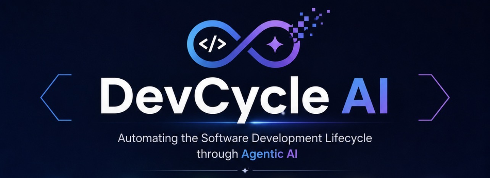

# DevCycle AI



> **DevCycle AI** — *Automating the Software Development Lifecycle through Agentic AI*

An **offline, edge-ready, Streamlit** workbench that turns a plain-language
instruction plus input/output expectations into a full software delivery, driven
by three collaborating agents:

| Agent | Role | Produces |
|-------|------|----------|
| 🏛️ **Software Architect** | Designs the system | Software Architecture Document (SAD) with a full diagram suite (overall architecture, component, data-flow, sequence, use-case — Mermaid) |
| 👩‍💻 **Software Developer** | Builds the system | Component design, source code, **unit tests**, **integration tests**, runs them, build/validation report |
| 🔎 **Validation Engineer** | Independently verifies | Functional & non-functional verification, architecture/design validation, **Excel validation report** (`.xlsx`) |

An embedded **English audio narration** (with always-on captions) walks a viewer
through every step of the agentic flow, so a demo is understandable without
reading code.

> **Runs completely on the edge.** The core flow performs **no external
> communication**. It works with no internet and inside a corporate network
> behind a proxy. Generated artifacts stay **local and confidential**.

---

## ✨ Key features

- **Three-agent SDLC pipeline** with dependency-ordered orchestration and live
  progress streaming.
- **Multi-language code generation** — choose the target language and the app
  generates idiomatic source, tests and a build manifest for it:

  | Language | Default unit-test framework | Alternatives | Build manifest |
  |----------|-----------------------------|--------------|----------------|
  | **Python** | pytest | unittest | `pyproject.toml` |
  | **Rust** | `cargo test` (built-in) | — | `Cargo.toml` |
  | **Java** | JUnit 5 | JUnit 4, TestNG | `pom.xml` |
  | **Kotlin** | Kotest | JUnit 5 | `build.gradle.kts` |
  | **C** | GoogleTest | — | `CMakeLists.txt` |
  | **C++** | GoogleTest | Catch2 | `CMakeLists.txt` |

- **Per-agent configuration** — each agent has its own options that steer what it
  produces and how it validates:
  - *Architect*: document detail level (brief / standard / detailed), the
    architecture diagram suite (overall architecture, component, data-flow,
    sequence and use-case — rendered as Mermaid), decision records (ADRs),
    risk register.
  - *Developer*: generate unit tests, integration tests, build manifest, and
    whether to execute the suite after generating.
  - *Validation Engineer*: independently re-run tests, static security scan,
    test:code coverage ratio, and whether to emit the Excel workbook.
- **Pluggable "brain"** configured in **Settings**:
  - **Local GGUF model** via `llama-cpp-python` (recommended offline brain) — no
    network, model downloaded once out of band.
  - **Local OpenAI-compatible endpoint** (Ollama / LM Studio / vLLM), proxy-aware.
  - **Deterministic offline engine** — zero model, zero network; the full flow
    (docs, code, tests, reports, narration) still works out of the box.
- **Real, runnable output**: generated projects are standard, idiomatic projects.
  Python tests run in-process on any device; for the other languages the tests
  execute when the toolchain (`cargo`, `mvn`, `gradle`, `cmake`) is installed and
  are reported as *skipped* (never a hard failure) when it is not.
- **Excel validation report** with sheets: `Summary`, `Functional`,
  `NonFunctional`, `Architecture`, `TestResults`, `CodeQuality` (colour-coded
  PASS / PARTIAL / FAIL).
- **Confidential by default**: artifacts stored locally with owner-only
  permissions, plus **optional at-rest encryption** (AES-GCM, or a built-in
  fallback cipher when `cryptography` isn't installed).
- **Offline audio narration** (`pyttsx3` + system eSpeak) with caption fallback.
- **Telemetry disabled** — Streamlit usage stats are turned off; nothing phones
  home.

---

## 🚀 Quick start

```bash
# 1. Install core dependencies (small; offline-friendly once cached)
pip install -r requirements.txt

# 2. (Optional) full offline capabilities: local model, voice, strong crypto
#    pip install -r requirements-full.txt

# 3. Launch (binds to 127.0.0.1, telemetry off)
./run.sh
#   or:  streamlit run app.py
#   or:  python -m sdlc_agents.cli
```

Open <http://127.0.0.1:8501>, go to **Workflow**, enter an instruction and your
input/output expectations, choose the agents, and click **Run agentic flow**.

---

## ⚙️ Configuration (Settings menu)

1. **Agent LLM connection** — pick `Offline engine`, `Local GGUF model`, or a
   `Local OpenAI-compatible endpoint`. See [`models/README.md`](models/README.md)
   for recommended small GGUF models.
2. **Generation parameters** — temperature, max tokens.
3. **Target language & unit-test framework** — choose from Python, C, C++, Java,
   Rust, Kotlin, and the unit-test framework for that language.
4. **Agent configuration** — per-agent options for the Architect, Developer and
   Validation Engineer (see *Per-agent configuration* above).
5. **Corporate proxy** — used *only* by the optional network endpoint; the core
   flow never needs it.
6. **Security & confidentiality** — `Offline-only mode` (hard-blocks all network
   backends) and `Encrypt artifacts at rest`.
7. **Demo narration** — enable/disable offline English audio, rate, volume, voice.

Settings persist locally as JSON under `SDLC_AGENTS_HOME` (default
`~/.sdlc_agents`, `0700`). Relocate everything (config + artifacts) to an
encrypted volume via:

```bash
export SDLC_AGENTS_HOME=/secure/volume/.sdlc_agents
```

---

## 🔒 Security & confidentiality model

- **No external communication in the core flow.** The only outbound path that
  exists at all is the optional, user-configured OpenAI-compatible endpoint —
  and enabling **Offline-only mode** blocks even that (the factory refuses to
  build a network backend).
- **Local, restricted artifact storage.** Each run writes to
  `SDLC_AGENTS_HOME/workspace/<run_id>` with owner-only permissions.
- **Optional at-rest encryption.** Artifacts are encrypted with a PBKDF2-derived
  key from a passphrase you enter per run; the passphrase is never persisted.
- **No model download in-app.** GGUF models must be placed on the device out of
  band (git-ignored), so nothing large or sensitive is fetched at runtime.

---

## 🧱 Architecture

```
app.py                     Streamlit entrypoint
sdlc_agents/
  config.py                Local JSON config (LLM, language, agents, proxy, security, audio)
  languages.py             Supported languages + per-language test frameworks
  analysis.py              Requirement analysis + role/task/prompt planning
  types.py                 Artifact / AgentResult / RunContext
  testrunner.py            Executes generated tests (pytest in-proc; cargo/mvn/gradle/ctest)
  codegen/                 Per-language code generators (python/rust/java/kotlin/c/cpp)
  llm/
    base.py factory.py     Backend interface + selection
    llama_cpp_backend.py   Local GGUF (offline)
    openai_compat_backend.py  Local OpenAI-compatible endpoint (proxy-aware)
    offline_engine.py      Deterministic doc/scaffold renderer (no model/network)
  agents/
    architect.py developer.py validation_engineer.py
    orchestrator.py        Pipeline + narration
  artifacts/
    store.py               Local confidential storage (+ encryption)
    excel_report.py        openpyxl validation workbook
  audio/narration.py       Offline TTS + captions
  security/crypto.py       AES-GCM (+ fallback) at-rest encryption
  ui/                      Streamlit views (workflow, settings)
tests/                     Unit + integration tests for the app itself
models/                    Drop local GGUF files here (git-ignored)
```

---

## 🧪 Development

```bash
pip install -r requirements.txt
python -m pytest -q
```

The test suite exercises requirement analysis, the offline engine (asserting the
generated code is valid Python and its tests pass), the language registry and
per-language code generators, the extended configuration model, the Excel
report, artifact encryption, and full end-to-end offline orchestration runs for
every supported language.

---

## 📝 License

MIT — see [`LICENSE`](LICENSE).
